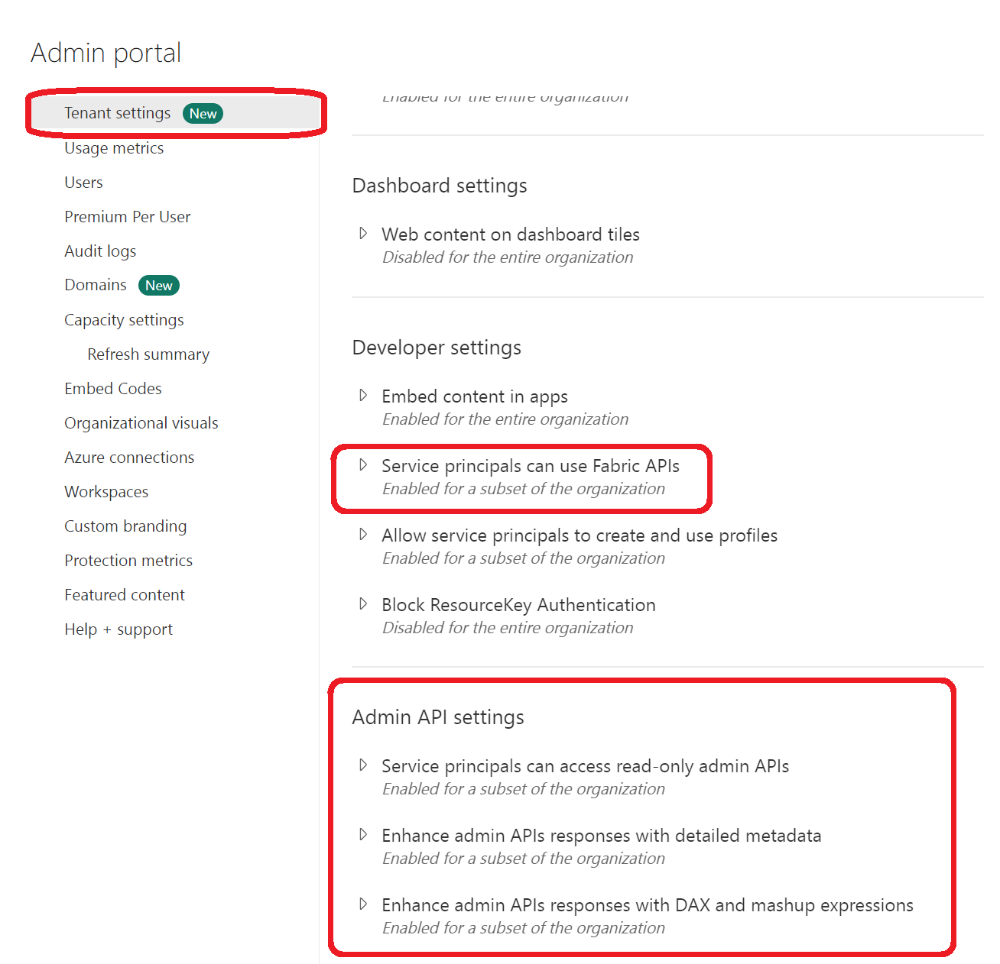
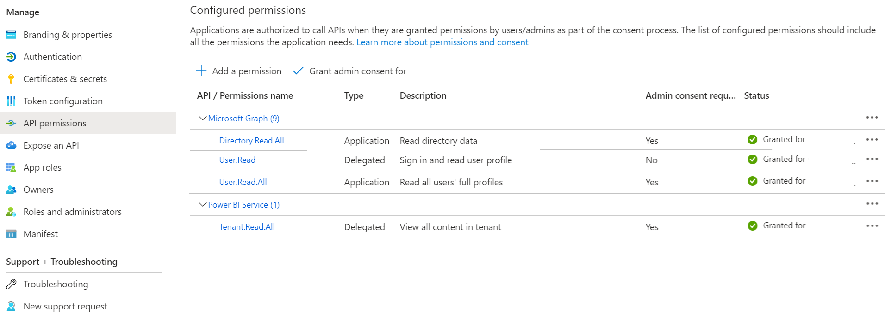
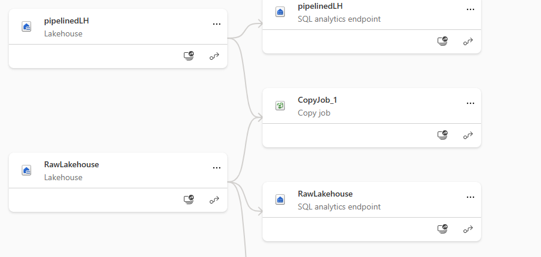
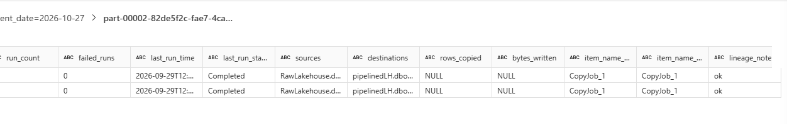
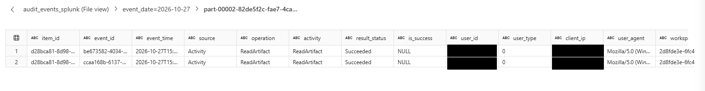

This project looks to take advantage of all the work put into the original Power BI Monitor application and port it to Fabric. This project has several components including a means of containerizing the application and for those enthusiasts that like to use Jupyter Notebooks a whole section is devoted to "BUILDING" the application but using notebooks.

**NOTE**  
The application was written using Python 3.10.13 and has successfully been tested up through Python 3.12.2. It is recommended that you install Python 3.12 however you may use Python 3.10.13. 

# Getting Started

What you need to do to use this application
1.	Create a Service Principal
2.	Grant permissions to the Service Principal  
    a. Fabric Admin Portal  
    b. Service Principal API permissions
3.	Create your .env file  
    a. Set the cron time for each module  
    b. Select which modules you would like the monitor application to use  
    c. Set `CLOUD_ENVIRONMENT` to `Commercial`, `Gcc`, `GccHigh`, or `Dod`  
4.	Using the application  
    a. Native Python Application  
    b. Docker Container  
    c. Notebooks  
    d. Arguments  
5.  Build and Test
    a. Local Testing  
        i. use Azureite for storage  
        ii. 
6.  Function Timer Trigger  
    a. Set Cron  
    b. Deploy  
7. Consuming Data  
    a. FabricMonitor-BlobStorage.PBIT  
    b. pbimonitorwithflow.pbit  
8. DataFlow  
    a. FabricFlow.json

## Create a Service Principal  
To use this application you will need to [create a service principal](https://learn.microsoft.com/en-us/entra/identity-platform/quickstart-register-app) in Microsoft Entra. This service principal will need to be granted specific permissions within the [Fabric Admin Portal](https://app.fabric.microsoft.com/admin-portal) and for those that would also like to capture information about users licenses and other privileged information will have to grant permissions to Microsoft Graph.

## Grant Permissions to the Service Principal
The service principal can have several permissions granted depending upon how much information you want to extract from the Fabric estate. The following will outline the what can be done and which permissions need to be granted  

### Fabric Admin Portal Settings  
You can grant specific permissions to service principals to use Fabric APIs including getting metadata of your Power BI semantic models. To enable this the service principal must be put into a group and that group will then be given permission to access the Fabric APIs

</img>

### Service Principal API permissions  
In order for the service principal to leverage all of the functionality of the Fabric Montior application you will will need to grant specific API permissions for the service principal. The following can be granted when editing the Service Principal in Microsoft Entra under the Apps section and API permissions.

#### Graph Permissions  
|API/Permissions Name|Type|Description|  
|---|---|---|
|Directory.Read.All|Application|Read Directory Data|
|User.Read|Delegated|Sign in and read user profile|  
|User.Read.All|Application|Read all user's full profile

#### Power BI  
|API/Permissions Name|Type|Description|  
|---|---|---|
|Tenant.Read.All|Delegated|View all content in tenant|

</img>

## Create your .env  
Your `.env` file will file will hold your information about what operations you want the appliction to undertake and will also include configuration for the service principal of which includes the client_id, client_secret, tenant_id, and environment. This code repository specifically prohibits the uploading of the `.env` file to your code repository as this will expose secrets. There is work currently underway to add Managed Identity **STAY TUNED**

> NOTE: USE the enclosed .env.exmple file to build your `.env` file

## Storing your Data  
You can determine where your data will be stored. In your `.env` you need to fill in information for a blob container if you want to store information to blob. If you would like to use a **FABRIC** Lakehouse then fill in the name of the Lakehouse and its required information and lastly, if you would like your data saved locally you can fill in a location in the local directory value. If you would like more storage capabilities then submit an issue and it can be placed on the backlog for consideration

## Using the Application  
This repository has three ways of using the application for gathering information from the Power BI and Fabric APIs. Every module in the application can be assigned a specific time to execute using the `cron syntax`. After executing the `Monitor.py` module the application will determine if the module should be executed. The application will then update the `State.yaml` file with a timestamp that will be used for further updates. If you would like to deploy your application to a container then you can leverage the Dockerfiles in the containers folders. There are two Dockerfiles, one will execute the application upon startup and the other is set up to be run as a `CRON` job. Both of these images are built from the latest version of Ubuntu.

### Understanding CRON
The `cron` statement is consists of 5 groups if time indicated by the asterisk. The syntax supports the use of commas or dashes to indicate more than one value. The following is the grouping for a `cron` statement. [Understanding cron](https://linuxhandbook.com/crontab/) and how to write simple to complex statements.  
```
* * * * *    Script/Command
| | | | |
| | | | |__ Day of the week (0-6) Sunday == 0  
| | | |____ Month of the year (1-12)  
| | |______ Day of the month (1-31)  
| |________ Hour of the day (0-23)  
|__________ Minute of the hour (0-59)  

```

The following will set the module to run every day of the week
```
* * * * 0-6
```

### Arguments  

The application can accept one argument that will retrieve all workspaces for the catalog that have been modified. This should be run at the beginning use of the Fabric Monitor and from that point on should be updated daily or monthly depending upon your needs. The following argument will cause the catalog to scan all modified workspaces.
```
python -m app.monitor --base True
```
or to run just the catalog module
```
python -m env.modules.catalog --base True
```

### Running as an Application  
You can run the code by using the following command from the root of this code to execute all the modules or you can run them singly:  
```
# to run the application
python -m app.monitor 

# run with a saved JSON profile
python -m app.monitor --profile .\profiles\local-monitor.json

# run with a specific .env file
python -m app.monitor --env-file .\.env

# full catalog workspace scan for this execution
python -m app.monitor --base

# run a subset of modules for this execution
python -m app.monitor --modules Activity,Catalog

# to run individual modules
python -m env.modules.<module name>
```

The standalone application loads `.env` automatically. The same configuration builder supports both current upper-case environment variable names and the older names from `env/.env.examples`.

Set `CLOUD_ENVIRONMENT` to choose the cloud endpoint profile. `Commercial` is the default. `Gcc`, `GccHigh`, and `Dod` switch Power BI, Graph, authority, and Azure Storage authentication endpoints to government cloud profiles. Fabric REST API and OneLake output modules are automatically skipped outside Commercial until Fabric Gov becomes public preview.

## Azure Synapse Notebooks

The monitor can also be run from Azure Synapse notebooks, including Synapse in Azure Government for GCC High scenarios. Notebooks run the Python monitor code and can write output to files, Blob Storage, or a downstream Synapse Dedicated SQL Pool load step.

See [Running the Monitor from Azure Synapse Notebooks](docs/azure-synapse-notebooks.md) for import options, notebook setup, required configuration, GCC High notes, and Dedicated SQL Pool loading patterns.

## Enterprise Deployment

For production deployments, use Azure Functions for scheduled data collection, ADLS Gen2 or Blob Storage for raw output, and Synapse for downstream curation/loading.

See [Enterprise Deployment Best Practices](docs/enterprise-deployment-best-practices.md) for cloud-specific guidance across Commercial, GCC, GCC High, and DoD.

## Windows UI Launcher

For a simple end-user experience on Windows, use:

```text
Run Fabric Monitor UI.cmd
```

The launcher creates a local virtual environment, installs dependencies on first run, and opens the Windows UI. Users can also run:

```text
Create Desktop Shortcut.cmd
```

to create a desktop icon.

See [Windows UI Release and Launcher](docs/windows-ui-release.md) for release zip and enterprise packaging guidance.

For Fabric notebooks, keep the repo files available in the notebook environment and call the notebook helper from a setup cell:

```python
from env.notebook import run

await run({
    "TENANT_ID": "<tenant-id>",
    "CLIENT_ID": "<client-id>",
    "CLIENT_SECRET": "<client-secret>",
    "APPLICATION_MODULES": "Activity,Catalog,Tenant",
    "LAKEHOUSE_NAME": "<lakehouse-name>",
    "WORKSPACE_NAME": "<workspace-name>",
    "PATH_IN_LAKEHOUSE": "FabricMonitor",
    "ON_FABRIC": True,
})
```

For local Python, use `OUTPUT_PATH` for local files or configure Blob Storage with either `STORAGE_ACCOUNT_CONNECTION_STRING` or `STORAGE_ACCOUNT_URL` plus `STORAGE_ACCOUNT_CONTAINER_NAME`.

### Running the Windows Desktop UI

For non-developer desktop use on Windows, create the virtual environment first. If this command fails:

```powershell
.\.venv\Scripts\Activate.ps1
```

then `.venv` has not been created yet.

Run the UI setup script from the repository root:

```powershell
cd C:\Projects\Fabric\monitor
.\setup-windows-ui.ps1
```

The setup script checks for Python 3.12, creates `.venv`, and installs `requirements.txt`. If only `3.12-arm64` is installed, the script uses ARM64-compatible dependency markers and skips packages that do not have Windows ARM64 wheels. If Python 3.12 is missing, install Python 3.12 from [python.org](https://www.python.org/downloads/) and rerun the script.

After setup succeeds, start the UI:

```powershell
.\.venv\Scripts\Activate.ps1
python -m app.windows_ui
```

If PowerShell blocks activation scripts, run this once:

```powershell
Set-ExecutionPolicy RemoteSigned -Scope CurrentUser
```

The UI lets users enter service principal settings, choose output storage, select modules, save/load JSON profiles, and run the monitor while viewing logs. See [docs/windows-ui.md](docs/windows-ui.md).

### Build Docker Image  
from the root of the application you can type the following commands to build your image  
```
docker build -t monitor/fabric:1.0 -f ./containers/Dockerfile2
```
> To build a CRON job that can execute based on schedules use the following to build

```
docker build -t monitor/fabric:cron -f ./containers/Dockerfile
```

### Using your Docker Image
Once you have your docker image created you can do several things with it. The first thing you can do is run the container from your local compute. Running the image locally gives the ability to see the application run and connect to the container to analyze the performance. Secondly, you could register your image with a container registry. Follow the link for publishing your image to [Azure Container Registry](https://learn.microsoft.com/en-us/azure/container-registry/container-registry-get-started-docker-cli?tabs=azure-cli). At this point you can now use that image in multiple services that host container images.

#### Register your image with Azure Container Registry

```
docker tag <localimage> <acr name>.azurecr.io/<image name>
docker push <acr name>.azurecr.io/<image name>
```

Learn how to use [Azure Kubernetes Service](https://learn.microsoft.com/en-us/azure/aks/tutorial-kubernetes-prepare-app) with your image  
Learn how to publish to [Azure Container Instance](https://learn.microsoft.com/en-us/azure/container-instances/container-instances-tutorial-prepare-app)  with your image  
Use [Azure Container Apps](https://learn.microsoft.com/en-us/azure/container-apps/managed-identity-image-pull?tabs=azure-cli&pivots=azure-portal) with your published container image


### Running Notebooks  
You can also run each module as a Jupyter notebook. This allows you to step through the processes and get a better understanding of the modules. Each notebook will have supporting links to the appropriate Power BI API or Fabric API.  The notebook will also allow you to experiment with the process and modify it to your needs. There is an `environment.yml` file that you can use with the *Anaconda* or *miniconda* package management. This file will create the appropriate virtual environment and will install all the necessary jupyter packages.

> Notebooks can be found in the notebook folder and each notebook will be named after a module that it mimics.


### Reports  
The power bi reports are templates that have parameters to fill in to populate the data. The simplest process is to set up a Dataflow Gen 1 in the Power BI Service and then use the Power BI template with flow. There is a defined flow where you will neeed to change the following in the json file  
```
<your account here> => the name of the storage account
<your container name here> => the name of the container in the storage account

you may not have to change the <capacity> but if you do you can find the capacity section of the url and replace it
```
You can also use the FabricMonitor and provide the name of the Storage account and the container name plus the UTC offset, RangeStart and RangeEnd along with your SAS or Account Key.

# Audit, lineage and Splunk export

Beyond the base modules, the monitor can collect item lineage, job runs and source/destination details, and a Fabric notebook consolidates everything into one flat table for Splunk.

## What each part collects

| Output folder (`Files/<PATH_IN_LAKEHOUSE>/`) | Module | Source API |
|---|---|---|
| `activity/` | Activity | Power BI `admin/activityevents` |
| `catalog/scans/` | Catalog | Power BI Scanner API (`getInfo`, `scanStatus`, `scanResult`) |
| `lineage_edges/` | Catalog (`env/utility/lineage_edges.py`) | Flattened from the scan results: one row per edge, upstream and downstream |
| `lineage/` | FabricItems | Fabric `relations/upstream` and `relations/downstream` (beta). Supplementary, it returns HTTP 500 for many item types |
| `jobs/` | ItemJobs | Fabric `items/{id}/jobs/instances` |
| `itemdefinitions/` | ItemJobs | Fabric `items/{id}/getDefinition` (copy jobs and pipelines): source and destination |
| `jobactivityruns/` | ItemJobs | Fabric `datapipelines/pipelineruns/{runId}/queryactivityruns`, including child pipeline runs: rows and bytes copied |
| `itemdetails/` | ControlPlane | Every item in scope from `v1/admin/items` (state, capacity, creator, last updated) plus the type-specific Fabric REST properties and description |
| `controlplane/` | ControlPlane | Consolidated, one row per item endpoint: source/destination, connection type, last run status, owner, workspace and item access (user principal names), and volume (pipeline Copy activities only). Reads the ItemJobs and Catalog outputs, so run Catalog and ItemJobs first. Also carries `UpstreamItems`/`DownstreamItems` (+ counts) from lineage and `LastActivity*`/`ActivityCount`/`ActivityUsers` from the last 7 days of `activity/` (matched on item ID). Copy job destinations to a Lakehouse table get `RowsWritten`/`BytesWritten` (`VolumeSource=DeltaLog`), read from the table's OneLake `_delta_log` |
| `lineagegraph/` | ControlPlane | One row per upstream -> downstream edge (Scanner `lineage_edges/` + Fabric `lineage/` merged) with each end's state, owner and latest activity (time, operation, user). Run Catalog, FabricItems and Activity first |
| `graph/` | Graph | Microsoft Graph users and group members (user display names) |

Add `ItemJobs` to `APPLICATION_MODULES` in your `.env` to collect jobs, definitions and volume. The endpoint inventory links each API to its official Microsoft Learn reference: [docs/api-endpoints.md](docs/api-endpoints.md).

**Access needed.** The Scanner lineage works with the admin API settings alone. The job, definition and volume calls also need the service principal to be a member of each workspace, because a service principal cannot add itself. Items in other workspaces return no job, source or destination data.

## Consolidating for Splunk

The master table is the Delta table `audit_events_splunk`: one row per audit event, enriched with user display name, item name, upstream and downstream lineage, run history, sources, destinations, volume, and the owner, state, last run and recent activity of the item. It is built by [notebooks/audit_events_splunk.ipynb](notebooks/audit_events_splunk.ipynb), which needs **only the JSON files the monitor modules write to your Lakehouse**. It does not depend on any other table, so you can build the master table in your own tenant from the modules alone. The notebook also writes JSON Lines to `Files/splunk_export/YYYY/MM/DD/`.

### Implementation steps

Follow these in order. Each step says how to confirm it worked.

1. **Prepare the service principal and Fabric.** Complete [Create a Service Principal](#create-a-service-principal) and [Grant Permissions to the Service Principal](#grant-permissions-to-the-service-principal) (Fabric admin API settings, Graph and Power BI permissions). Add the service principal as a member of every workspace you want job, definition and volume data from, because it cannot add itself.
2. **Create or choose the Lakehouse** that will hold both the raw module output and the master table (for example `fabricauditlh`) in a Fabric workspace you can write to.
3. **Configure `.env`** (start from `local.settings.example`; all names are in [docs/configuration-reference.md](docs/configuration-reference.md)):
   ```
   APPLICATION_MODULES=Activity,Graph,Catalog,FabricItems,ItemJobs,ControlPlane
   LAKEHOUSE_NAME=<lakehouse name>
   WORKSPACE_NAME=<workspace name>
   PATH_IN_LAKEHOUSE=fabricmonitor
   ON_FABRIC=true          # true when the modules run inside Fabric, false when they run elsewhere and write to OneLake
   HTTP_MAX_RETRIES=6      # optional, see "Throttling and HTTP retries" below
   ```
   Optionally set `INCLUDE_WORKSPACE_IDS` / `EXCLUDE_WORKSPACE_IDS` to limit scope.
4. **Run the modules in this order.** Later modules read earlier output, so the order matters. Run them once for a full backfill (`python -m app.monitor --base --modules ...`), then on a schedule.

   | Order | Module | Writes | Feeds these master table columns |
   |---|---|---|---|
   | 1 | Activity | `activity/` | The events themselves: `event_id`, `event_time`, `operation`, `status`, `user_id`, `client_ip`, workspace, capacity and item columns |
   | 2 | Graph | `graph/` | `user_display_name` |
   | 3 | Catalog | `catalog/scans/`, `lineage_edges/` | `item_name`, `upstream_*`, `downstream_*`, `data_sources`, `has_lineage`, `lineage_note` |
   | 4 | FabricItems | `items/`, `lineage/` | Supplementary lineage |
   | 5 | ItemJobs | `jobs/`, `itemdefinitions/`, `jobactivityruns/` | `run_count`, `failed_runs`, `last_run_status`, `last_run_time`, `sources`, `destinations`, `rows_copied`, `bytes_written` |
   | 6 | ControlPlane | `controlplane/`, `lineagegraph/`, `fabric_audit/` | `cp_owner_principal`, `cp_item_state`, `cp_last_run_status`, `cp_last_run_end`, `cp_last_run_failure_reason`, `cp_runs_collected`, `cp_failed_runs`, `cp_last_activity`, `cp_last_activity_time`, `cp_last_activity_user`, `cp_activity_count_7d`, `cp_activity_users` |

   Confirm: in the Lakehouse, open **Files > fabricmonitor** and check that each folder above contains `YYYY/MM/DD` subfolders with `.json` files.
5. **Import the notebook.** In the Fabric workspace choose **Import > Notebook** and select `notebooks/audit_events_splunk.ipynb`. Attach the Lakehouse from step 2 as the **default Lakehouse**. If `PATH_IN_LAKEHOUSE` is not `fabricmonitor`, change `base_path` in the first cell.
6. **Run the notebook (first run).** Select **Run all**. The preflight cell lists every source folder as `OK` or `MISSING` and names the module to run for each missing one. It stops only when `activity/` is empty; other missing folders just leave the related columns empty. The notebook then builds `audit_events_splunk`, exports JSON Lines, and prints row counts and data quality checks.
7. **Verify the table.** Open the Lakehouse **Tables** list, or run in a notebook or the SQL analytics endpoint:
   ```sql
   SELECT source, COUNT(*) AS events FROM audit_events_splunk GROUP BY source;
   SELECT item_name, operation, status, user_display_name, cp_owner_principal, cp_last_run_status,
          cp_activity_count_7d, lineage_note
   FROM audit_events_splunk ORDER BY event_time DESC LIMIT 20;
   ```
8. **Schedule it.** Create a Data Factory pipeline whose Notebook activity runs the notebook after the module run finishes (see [Orchestrate refreshes](#orchestrate-refreshes)). Run the notebook at least once per 30 days, because the activity API returns at most 30 days.

### How the notebook builds the table

- **Source of truth:** only `Files/<PATH_IN_LAKEHOUSE>/` JSON from the modules. Every source is optional except `activity/`.
- **Joins:** every enrichment is a left join keyed on the lower-cased item ID, and the notebook fails if the row count changes. `controlplane/` is reduced to one row per item from its newest `YYYY/MM/DD` snapshot, so it cannot multiply rows.
- **Write:** a MERGE on `event_id`, partitioned by `event_date`. Schema auto-merge is on, so columns added by a newer version of the notebook are added to an existing table.
- **Adding the new `cp_*` columns to an existing table:** the incremental run only enriches new events. Set `REBUILD = True` in the first cell for one run to fill the new columns for existing rows, then set it back to `False`.

### Throttling and HTTP retries

Every module calls the Power BI, Fabric and Graph APIs through one shared client ([env/utility/http.py](env/utility/http.py)). It retries HTTP 429, any 5xx and network failures, up to `HTTP_MAX_RETRIES` times (default 6). It waits for the server's `Retry-After` header (up to one hour) or uses exponential backoff from 2 to 60 seconds with jitter. Other 4xx responses (400, 401, 403, 404) are never retried. Each retry is logged as `HTTP retry: status=... attempt=n/m wait=...s path=...`.

This is not the same as the run retries in the table. `cp_runs_collected` and `cp_failed_runs` describe how the customer's own jobs ran. The HTTP retries only decide whether a module manages to collect its data.

If a module still fails after its retries, rerun that module, then rerun the notebook. Because the master table merges on `event_id`, reruns do not create duplicates.

### Troubleshooting

| Symptom | Cause and fix |
|---|---|
| Preflight raises `No data under Files/fabricmonitor/` | `activity/` is empty. Run the Activity module, and check `PATH_IN_LAKEHOUSE` matches `base_path` in the notebook. |
| `MISSING controlplane` | Run ControlPlane after Catalog and ItemJobs. Until then the `cp_*` columns are empty. |
| `lineage_note` is `item not in lineage_edges` | The item was not in a Catalog scan. Run Catalog with `--base`. |
| `lineage_note` is `no relations in scanner` | The scanner returned no relations for that item. This is expected for some item types. |
| Job, source or volume columns are empty for some items | The service principal is not a member of that item's workspace. Add it and rerun ItemJobs and ControlPlane. |
| Many `HTTP retry: status=429` lines | Power BI admin throttling. Wait for the run to finish, run fewer modules at once, or narrow scope with `INCLUDE_WORKSPACE_IDS`. |
| Notebook fails with `Row count changed after enrichments` | A lookup has duplicate keys. Check the source folder for duplicated item IDs. |
| New columns are empty for old events | Run once with `REBUILD = True`. |

### Notebook behavior

- The notebook is incremental. If you change the enrichment logic, set `REBUILD = True` in the first cell for one run so existing rows are recomputed.
- Every join is a left join and the notebook fails if the row count changes.
- Item IDs prefer source GUID fields and ignore the all-zero GUID placeholder; item type falls back to `ArtifactKind`. The normalized `status` column is added alongside the original result/success fields.
- `lineage_note` explains blanks: `no item id on event`, `item not in lineage_edges`, `no relations in scanner` or `ok`.
- Lineage, runs, sources and volume belong to the item, so every event on the same item carries the same values.

### Convert the JSONL export into a Delta table

The export is stored as Spark part files beneath `Files/splunk_export/YYYY/MM/DD/audit_events.jsonl/`; it is not one physical `.jsonl` file. To materialize those records as a tabular Delta table without changing the canonical table, import [notebooks/jsonl_to_delta.ipynb](notebooks/jsonl_to_delta.ipynb), attach the same Lakehouse as its default Lakehouse, and run it. The notebook reads the JSON part files and overwrites the separate `audit_events_splunk_jsonl` table, then verifies that its row count matches the JSONL input. Run the audit notebook first so the export exists. The conversion notebook is a full refresh of this separate table each time it runs.

### Orchestrate refreshes

| Option | How to use it | Best for / trade-off |
|---|---|---|
| Run manually in Fabric | Open the notebook and select **Run all**. For JSONL materialization, run the converter after the audit export finishes. | Development, troubleshooting, or one-time backfills; requires a person to start and monitor each run. |
| Fabric Data Factory pipeline (recommended for routine runs) | Create a pipeline with a Notebook activity for `audit_events_splunk`; add a dependent Notebook activity for `jsonl_to_delta` only if you need the extra JSONL-derived table. Configure a schedule or an event trigger on the pipeline. | Native Fabric monitoring, dependency handling, retry configuration and scheduling. Use the pipeline's run history to inspect each activity. |
| Fabric REST API | Submit a notebook job instance for the audit notebook and, after it succeeds, submit the converter job if required. Poll the returned job-instance status and surface failures to the caller. | Programmatic, on-demand execution from a controlled service; caller must handle authentication, sequencing, retries and status polling. |
| External orchestrator | An Azure Data Factory or another scheduler can call the Fabric REST API, or use its supported Fabric integration, and wait for job completion before starting the optional converter. Keep the Fabric notebook as the compute step. | Existing cross-platform workflows; adds external identity, networking and operational dependencies. |

Fabric references: [Notebook activity](https://learn.microsoft.com/en-us/fabric/data-factory/notebook-activity), [run, schedule, or trigger a pipeline](https://learn.microsoft.com/en-us/fabric/data-factory/pipeline-runs), [use a notebook](https://learn.microsoft.com/en-us/fabric/data-engineering/how-to-use-notebook), [run a notebook job with the REST API](https://learn.microsoft.com/en-us/rest/api/fabric/notebook/background-jobs/run-on-demand-notebook), and [Fabric REST API overview](https://learn.microsoft.com/en-us/rest/api/fabric/).

## Validating the results

Lineage for a copy job in the Fabric portal (RawLakehouse to `CopyJob_1` to pipelinedLH):



The same item in `audit_events_splunk`: last run, source, destination and `lineage_note = ok`:



An exported event file (user and client IP redacted):



## Known limits

- No public API returns the portal's full lineage view. The Scanner relations are the main source and the Fabric beta relations API only supplements them.
- Copy-job runs return no activity-level rows or bytes, so volume is only available for pipeline copy activities.
- The activity API returns at most 30 days, and scans only cover workspaces modified since the last run.
- Storage-level events (reads and writes through OneLake) require OneLake diagnostics to be enabled on the workspace.

# Build and Test
TODO: Describe and show how to build your code and run the tests. 

# Contribute
TODO: Explain how other users and developers can contribute to make your code better. 

If you want to learn more about creating good readme files then refer the following [guidelines](https://docs.microsoft.com/en-us/azure/devops/repos/git/create-a-readme?view=azure-devops). You can also seek inspiration from the below readme files:
- [ASP.NET Core](https://github.com/aspnet/Home)
- [Visual Studio Code](https://github.com/Microsoft/vscode)
- [Chakra Core](https://github.com/Microsoft/ChakraCore)
