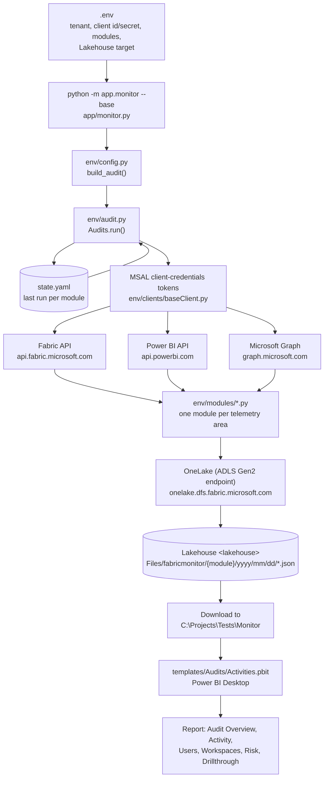
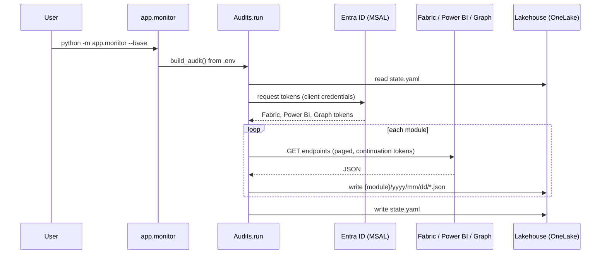

# Fabric Monitor: Audit Run Runbook

How the audit was run end to end, from configuration to the Power BI report.

## Visual flow



## Sequence of one run



## 1. Prerequisites

| Item | Requirement |
|---|---|
| App registration | Service principal with a client secret |
| Graph permissions | **Application** type (not Delegated), admin consent granted |
| Power BI Service permissions | None. Do not add `Tenant.Read.All` |
| Fabric tenant settings | "Service principals can access read-only admin APIs" and "...admin APIs used for updates" enabled for a **security group that contains the service principal** |
| Workspace access | Service principal has access to the target workspace for OneLake writes |
| Python | 3.11 virtual environment in `.venv` with `requirements.txt` installed |

## 2. Configuration (`.env` in the repo root)

| Setting | Value used |
|---|---|
| `CLOUD_ENVIRONMENT` | Commercial |
| `APPLICATION_MODULES` | Activity, Apps, Capacity, Catalog, Domains, FabricItems, Gateway, Graph, Refreshables, RefreshHistory, Roles, Tenant, Workspaces |
| `ALL_WORKSPACES` | true |
| `WORKSPACE_NAME` / `LAKEHOUSE_NAME` / `PATH_IN_LAKEHOUSE` | `<your workspace>` / `<your lakehouse>` / `fabricmonitor` |
| `ON_FABRIC` | false (running from Windows, writes go through the service principal) |

`CapacityMetrics` is excluded because it needs `CAPACITY_METRICS_DATASET_ID`.

## 3. Run

```powershell
cd "<repo root>"
.\.venv\Scripts\python.exe -m app.monitor --base
```

## 4. Source code map

| Step | File |
|---|---|
| CLI entry | `app/monitor.py` |
| Config to settings | `env/config.py` |
| Orchestration, `state.yaml` | `env/audit.py` |
| Token acquisition, Bearer header | `env/clients/baseClient.py` |
| HTTP calls, 300 s timeout | `env/context.py` (`invokeAPI`) |
| Cloud base URLs and scopes | `env/cloud.py` |
| Lakehouse read/write | `env/utility/fabric.py`, `env/utility/file_management.py` |
| Endpoint calls | `env/modules/*.py` |

Endpoint list: [api-endpoints.md](api-endpoints.md).

## 5. Timeline

| Behavior | Detail |
|---|---|
| First run | `audit.py` creates `state.yaml` with a **7-day lookback** |
| Activity events | `activity.py` loops **one day at a time** (24-hour windows) from the last-run date, following continuation tokens |
| Later runs | Resume from `state.yaml`, so only new data is fetched |
| Observed run time | About 90 seconds for this tenant |

Data pulled in the first run covered 2026-10-15 to 2026-10-22.

## 6. Output layout

```
<lakehouse>.Lakehouse/Files/fabricmonitor/
  activity/yyyy/mm/dd/*.json
  catalog/scans/yyyy/mm/dd/*.scanResults.json
  capacity/  domains/  gateways/  graph/  items/
  roles/  tenant/  workspaces/
  datasetrefresh/  datasetrefreshable/
  state.yaml
```

## 7. Report

`templates/Audits/Activities.pbit` reads **local folders**, not the Lakehouse. Its paths are hardcoded:

| Query | Path |
|---|---|
| `activity` | `C:\Projects\tests\monitor\activity` |
| Catalog tables | `C:\Projects\Tests\monitor\catalog\scans` |
| Graph tables | `C:\Projects\Tests\Monitor` (file must sit in a `graph` folder) |
| `Sample File` | `C:\Projects\Fabric\monitor-output\activity` |

Steps:
1. Download `Files/fabricmonitor` from the Lakehouse to `C:\Projects\Tests\Monitor`, keeping the folder structure.
2. Copy the `activity` folder to `C:\Projects\Fabric\monitor-output`.
3. Open the `.pbit`. Leave `Parameter1` on **Sample File** and click Load.
4. Save as `.pbix`.

## 8. Troubleshooting seen

| Symptom | Cause | Fix |
|---|---|---|
| `ModuleNotFoundError: azure.storage.filedatalake` | Dependencies not installed | Create `.venv` and install `requirements.txt` |
| OneLake `Forbidden` | Service principal lacks workspace access | Grant access to the workspace |
| Graph 403 | Permissions were Delegated | Use Application permissions and grant consent |
| Fabric admin 401 / Power BI admin 401 and timeouts | Service principal not in the allowed security group, or `Tenant.Read.All` present | Add it to the group, apply settings, remove the permission, wait for propagation |
| `Customer Audit Overview` page empty | Date slicer set outside the data range | Set the slicer to the data range |
| Refresh history 404s | Datasets without refresh support | Expected, ignore |
| Empty gateway files | No gateways in the tenant | Expected |
